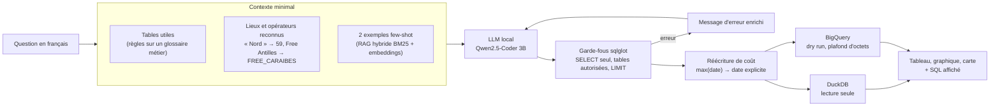

<div align="center">

# 📡 NetQuery

**Interroger les données des réseaux mobiles français en langage naturel.**

Un assistant text-to-SQL qui répond en français à des questions sur les pannes et le déploiement
des réseaux 2G à 5G, avec un LLM local, des garde-fous de sécurité et un contrôle des coûts sur BigQuery.


</div>

---

## En une question

> **« Combien de sites Orange étaient en panne hier dans le Nord ? »**

```sql
SELECT COUNT(*) AS nb_sites
FROM fact_indispo_site
WHERE operateur_id = 'ORANGE'
  AND departement = '59'                     -- « Nord » reconnu et converti en code
  AND date = CAST('2026-11-24' AS DATE)      -- « hier » réécrit en date explicite (partition éliminée)
LIMIT 1000
```

**→ 15 sites.** Requête générée par un modèle de 3 milliards de paramètres tournant sur un simple CPU,
validée, exécutée en lecture seule, **30 Ko lus sur BigQuery**.

## Résultats clés

| | Version naïve | NetQuery | |
|---|:---:|:---:|---|
| **Exactitude** sur 66 questions inédites | 29 % | **67 %** | ×2,3 à modèle identique |
| **Erreurs SQL** (colonnes inventées, jointures fausses) | 22 | **0** | garde-fous et auto-correction |
| **Taille du prompt** | 2 732 tokens | **1 285** | seules les tables utiles sont envoyées |
| **Octets lus sur BigQuery** (médiane) | 4,4 Mo | **0,5 Mo** | ÷9 grâce aux partitions et à la réécriture |
| **Question déjà posée** | 38 s | **3 s** | cache exact, sans appel au LLM |

Tout est mesuré par un banc d'évaluation reproductible ([`eval/rapport.md`](eval/rapport.md)).

## Pourquoi ce projet

Chez un opérateur télécom, les données réseau vivent dans un entrepôt cloud **facturé à la requête**.
Un assistant qui « parle SQL » n'y est utile que s'il produit des requêtes **justes**, **sûres** et
**peu coûteuses**. NetQuery traite les trois, sur des données publiques réelles :

| Source | Contenu | Volume chargé |
|---|---|---|
| [Arcep, Sites indisponibles](https://www.data.gouv.fr/datasets/sites-indisponibles) | Sites mobiles hors service déclarés chaque jour par Orange, SFR, Bouygues Telecom et Free, par service (voix, data) et technologie | 30 jours, 41 786 relevés |
| [ANFR, Données sur les réseaux mobiles](https://www.data.gouv.fr/datasets/donnees-sur-les-reseaux-mobiles) | Émetteurs 2G/3G/4G/5G : opérateur, bande, localisation, hauteur, mise en service | 816 040 émetteurs, 139 623 sites |
| [API Découpage administratif](https://geo.api.gouv.fr/decoupage-administratif) | Communes, départements, régions, population | 35 000 communes |

## Architecture



Pipeline de données : **ingestion** (Parquet partitionné par jour) → **staging** typé et nettoyé →
**modèle en étoile** (`dim_`, `fact_`, `agg_`) avec 21 contrôles qualité → **schéma sémantique** en YAML
(descriptions, valeurs possibles, glossaire) validé automatiquement contre la base.

## Décisions techniques, chacune mesurée

**1. Le contexte compte plus que le modèle.** À modèle égal, n'envoyer que les tables utiles, un glossaire
métier et les lieux reconnus fait passer l'exactitude de 29 % à 62 % et divise le prompt par deux.
Indispensable avec un modèle local limité à 4 096 tokens de contexte.

**2. Une auto-correction qui guide le modèle.** Renvoyer l'erreur DuckDB brute ne suffisait pas : le modèle
répétait trois fois la même faute. En ajoutant *« la colonne `operateur_id` se trouve dans `fact_indispo_site`
(alias f) »*, il corrige au premier nouvel essai.

**3. Le RAG classe par structure avant de classer par sens.** Les embeddings trouvent des exemples proches
(même table principale dans 13 cas sur 20, contre 10 pour BM25 seul), mais un petit modèle recopie
l'exemple voisin, filtres compris. Les exemples sont donc choisis d'abord sur les tables utilisées,
puis sur la similarité : +5 points.

**4. Une sous-requête qui coûte 28 fois plus.** Le modèle écrit « hier » sous la forme
`date = (select max(date) ...)`, ce qui empêche BigQuery d'éliminer les partitions. Une réécriture
automatique, sans effet sur le résultat (vérifié sur 64 requêtes), remplace la sous-requête par la date :

| « Sites en panne hier dans le Rhône » | Octets lus |
|---|---:|
| avec `select max(date)` | 500 Ko |
| sans aucun filtre de date | 167 Ko |
| **date explicite** (partition éliminée) | **18 Ko** |
| date explicite + table agrégée | 6 Ko |

**5. Un cache exact, pas de cache sémantique.** Mesuré avec les embeddings du projet : « pannes **4G** hier »
et « pannes **5G** hier » sont plus proches (cosinus 0,868) que deux vraies reformulations d'une même
question (0,861). Un cache par similarité renverrait la réponse d'une autre question.

**6. Une traduction DuckDB → BigQuery vérifiée.** Les 86 requêtes de référence donnent exactement le même
résultat sur les deux moteurs, après correction d'un piège silencieux : `WEEK` commence le dimanche
en BigQuery et le lundi en DuckDB, ce qui décalait « la semaine dernière » d'un jour.

## Sécurité

Le SQL généré par un LLM est traité comme une entrée non fiable :

- une seule instruction, `SELECT` uniquement, vérifiée sur l'arbre syntaxique (sqlglot) ;
- uniquement les tables du modèle : pas de tables brutes, de tables système ni de `read_csv` ;
- `LIMIT` ajouté ou abaissé automatiquement, délai maximal d'exécution ;
- DuckDB ouvert en lecture seule, accès aux fichiers coupé, configuration verrouillée ;
- BigQuery : estimation par dry run, refus au-delà d'un seuil, `maximum_bytes_billed` ;
- aucune clé dans le code (`.env`), 72 tests dont des tentatives d'injection (`DROP`, requêtes multiples,
  lecture de fichiers).

## Évaluation

66 questions de test, **jamais montrées au modèle**, avec leur requête de référence. Une réponse est juste
si son résultat égale celui de la référence (ordre des lignes, noms et colonnes en plus ignorés).

| Catégorie | Naïve | Sans RAG | NetQuery |
|---|:---:|:---:|:---:|
| Pannes | 2/10 | 7/10 | 7/10 |
| Technologie | 6/10 | 6/10 | 6/10 |
| Géographie | 2/10 | 7/10 | 8/10 |
| Temps | 1/8 | 3/8 | 2/8 |
| Déploiement | 5/12 | 9/12 | 9/12 |
| Parc de sites | 3/6 | 4/6 | 4/6 |
| Ancienneté et causes | 0/6 | 3/6 | 5/6 |
| Outre-mer | 0/4 | 2/4 | 3/4 |
| **Total** | **29 %** | **62 %** | **67 %** |

**Limites, honnêtement.** Les échecs restants sont des erreurs de sens et non de syntaxe : recopie
d'un filtre d'exemple, confusion entre technologie et service, questions temporelles (« le week-end dernier »,
moyennes par jour). Après le premier passage, 4 références discutables du jeu ont été corrigées (détail en tête de
[`eval/questions.yaml`](eval/questions.yaml)), mais **le prompt n'a pas été ajusté sur les échecs**, pour ne pas
optimiser sur le jeu de test. Un seul modèle, une seule exécution à température 0.

## Démarrage rapide

```powershell
git clone https://github.com/AmineBnh21/netquery.git
cd netquery
python -m venv .venv
.venv\Scripts\Activate.ps1          # Linux/macOS : source .venv/bin/activate
pip install -r requirements.txt

# modèles locaux
winget install Ollama.Ollama
ollama pull qwen2.5-coder:3b
ollama pull paraphrase-multilingual
copy .env.example .env

# données : téléchargement (30 derniers jours), modèle, contrôles qualité
python scripts/ingest.py all --days 30
python scripts/transform.py

# poser une question
python -m netquery.pipeline "Combien de sites SFR étaient en panne 4G dans le Rhône la semaine dernière ?"
streamlit run app.py
```

<details>
<summary><b>Toutes les commandes</b> (BigQuery, évaluation, outils)</summary>

```powershell
# ingestion par source
python scripts/ingest.py indispo --start 2026-10-01 --end 2026-10-31
python scripts/ingest.py anfr
python scripts/ingest.py geo
python scripts/ingest.py profile          # data/schema_profile.md

# contrôles
python scripts/transform.py --checks      # qualité du modèle
python -m netquery.schema --check         # schéma sémantique cohérent avec la base
python -m netquery.prompt --check         # exemples few-shot valides
python -m netquery.evaluate --check       # requêtes de référence valides
python -m pytest

# voir ce que reçoit le LLM
python -m netquery.prompt "Combien de sites Free en Guadeloupe ?"

# BigQuery (gcloud auth application-default login, GCP_PROJECT dans .env)
python scripts/load_bigquery.py
# puis NETQUERY_BACKEND=bigquery dans .env

# évaluation (environ 30 min par version sur CPU, reprend là où elle s'est arrêtée)
python -m netquery.evaluate --config naive sans_rag optimise
python -m netquery.evaluate --report
```

</details>

<details>
<summary><b>Modèle de données</b></summary>

```
dim_operateur    (operateur_id, nom, est_metropole)          ORANGE, SFR, BOUYGUES, FREE + outre-mer
dim_departement  (departement, nom, region_code, region)
dim_commune      (code_insee, nom, departement, region, population, ...)
dim_date         (date, annee, trimestre, mois, semaine_iso, jour_nom, est_weekend, ...)
dim_site         (site_id, operateur_id, support_id, departement, lat, lon, hauteur_m, a_2g ... a_5g, ...)

fact_station       un émetteur ANFR par ligne : techno, bande, statut, est_actif, date de mise en service
fact_indispo_site  un site hors service par jour : raison, voix_hs, data_hs, début, fin prévue, ancienneté
fact_indispo       format long : site x jour x service x techno, est_hs

agg_sites_hs_dept_jour  sites indisponibles par jour, département et opérateur
agg_indispo_dept_jour   sites HS par jour, département, opérateur, service et techno
```

Choix notables :

- un **site** est une station ANFR, clé commune aux deux sources (99,7 % de correspondance) ;
- les faits portent le département pour éviter une jointure et servir de clé de clustering ;
- dans l'ANFR, les émetteurs 5G ne sont jamais « En service » mais « Techniquement opérationnel » :
  `est_actif` regroupe les deux (un filtre naïf faisait disparaître toute la 5G) ;
- en outre-mer, les codes opérateurs changent (Free aux Antilles = `FREE_CARAIBES`) : ils sont lus
  dans la base au moment de la question.

</details>

<details>
<summary><b>Structure du projet</b></summary>

```
scripts/
  ingest.py            téléchargement (cache), Parquet partitionné, DuckDB, profil du schéma
  transform.py         raw → staging → modèle, 21 contrôles qualité
  load_bigquery.py     chargement BigQuery (partitions par jour, clustering)
sql/staging, sql/model requêtes de transformation versionnées
semantic/
  schema.yaml          tables, colonnes, valeurs possibles, jointures, partitions
  glossaire.yaml       vocabulaire métier → tables et indices SQL
  exemples.yaml        20 exemples question → SQL
netquery/
  prompt.py            choix des tables, lieux, opérateurs, exemples
  retrieval.py         recherche hybride BM25 + embeddings (fusion RRF)
  llm.py               client générique compatible OpenAI (Ollama par défaut)
  sql_guard.py         garde-fous et exécution DuckDB en lecture seule
  pipeline.py          question → SQL → résultat, auto-correction
  bigquery_backend.py  traduction DuckDB → BigQuery, dry run, seuil de coût
  optimize.py          réécriture « dernier relevé »
  cache.py             cache des questions
  evaluate.py          banc d'évaluation et rapport
eval/                  66 questions de test, résultats par version, rapport
tests/                 72 tests pytest (faux LLM, sans réseau)
app.py                 interface Streamlit
```

</details>

## Feuille de route

- [x] Ingestion, staging, modèle en étoile et contrôles qualité
- [x] Schéma sémantique et glossaire métier
- [x] Génération SQL, garde-fous, auto-correction, interface Streamlit
- [x] RAG hybride pour les exemples few-shot
- [x] Banc d'évaluation (66 questions, 3 versions comparées)
- [x] BigQuery : partitions, dry run, plafond de coût, réécriture, cache
- [ ] Questions de suivi (« Et pour Bouygues ? ») et demande de clarification
- [ ] Carte des sites en panne
- [ ] Nouveau jeu de questions pour valider les pistes d'amélioration (questions temporelles, modèle plus grand)

## Auteur

**Mohamed Amine Benhamaid**, Master 2 Intelligence Artificielle, Université Claude Bernard Lyon 1

[](https://github.com/AmineBnh21)
[](https://www.linkedin.com/in/mohamed-amine-benhamaid)

<sub>Données publiques Arcep et ANFR (data.gouv.fr) et référentiel géographique geo.api.gouv.fr ; vérifier la licence de chaque jeu avant réutilisation.</sub>
